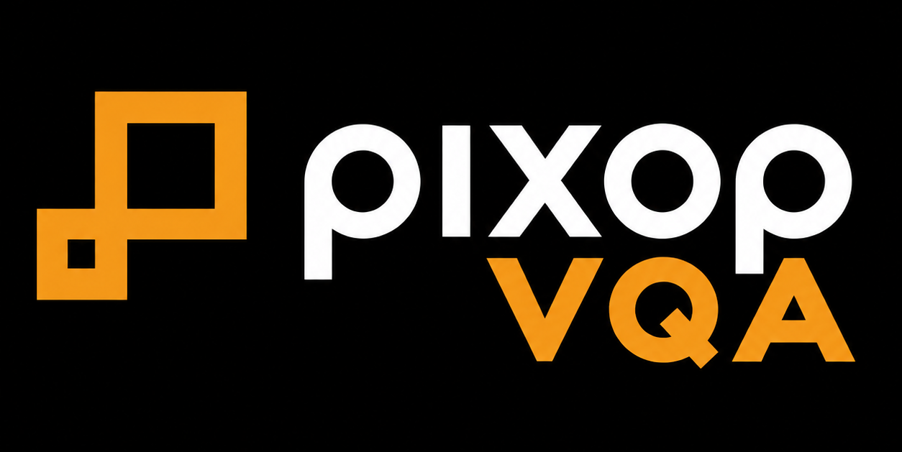

<p align="center">
  
</p>

# PixVQA — Video Quality Assessment by Pixop

[](https://github.com/pixop/pixvqa/actions/workflows/qa.yml) [](https://ffmpeg.org/) [](https://github.com/Netflix/vmaf) [](LICENSE)

PixVQA evaluates video quality using full-reference metrics and optional learned-model backends. It accepts raw planar YUV, or compressed video with an FFmpeg-enabled build, and prints per-frame scores and summaries where supported. Native metric output is text-based; learned backends have their own output options.

## Capabilities

- **Full-reference metrics:** PSNR, XPSNR, SSIM, MS-SSIM, VMAF, and PU21-PSNR/SSIM/MS-SSIM.
- **Optional learned metrics:** ColorVideoVDP (`cvvdp`, full-reference JOD) and CompressedVQA-HDR NR (`cvqa-hdr-nr`, no-reference). They require separate Python environments and model assets.
- **SDR and HDR:** SDR, PQ, and HLG metric groups with unified transfer/color configuration.
- **Input and acceleration:** raw YUV; compressed formats with FFmpeg; optional CUDA metric backends and NVDEC for supported streams.
- **Temporal analysis:** optional Quality Consistency Score (QCS).

Supported formats, backends, and metric-specific restrictions are documented in [Metrics & Formats](docs/METRICS_AND_FORMATS.md). In particular, not every metric accepts every input or transfer function.

## Quick start

**Platform:** Linux x86-64, including Ubuntu 22.04/24.04 and WSL2. Native Windows builds are not validated.

```bash
git clone https://github.com/pixop/pixvqa.git
cd pixvqa
bash install_pixvqa.sh
./bin/pixvqa --version
```

The guided installer lets you choose CPU-only, FFmpeg software decoding, or optional CUDA/NVDEC functionality. CUDA/NVDEC requires a suitable NVIDIA driver and CUDA toolkit 12.8. For the examples below, choose an FFmpeg-enabled build.

Compare the bundled HEVC samples:

```bash
./bin/pixvqa --metrics psnr,ssim,msssim \
  -r samples/ref_hevc.mp4 \
  -t samples/dist_hevc.mp4
```

Run the post-installation smoke QA:

```bash
python3 scripts/run_qa.py --profile smoke
```

For raw YUV, build variants (`make cpu`, `make swdec`, `make full`), and installation details, see [Getting Started](docs/GETTING_STARTED.md). Builds made with `make` are written to `build/<variant>/pixvqa`; they do not automatically replace `./bin/pixvqa`.

## Common workflows

**Individual metrics:** use `--metrics psnr,ssim,msssim,vmaf` or another comma-separated list. **Metric groups:** `--metrics sdr`, `--metrics pq`, and `--metrics hlg` select transfer-appropriate metrics and defaults; see [CLI metric groups](docs/CLI_USAGE.md#metric-groups).

**Learned metrics:** ColorVideoVDP (`cvvdp`, full-reference) and CompressedVQA-HDR NR (`cvqa-hdr-nr`, no-reference) require external Python dependencies and model files. They can be combined with **native metrics** in `--metrics` and are included in compatible metric groups. See [Learned metrics](docs/LEARNED_METRICS.md).

**Device selection:** `--device cpu|gpu|auto` controls supported metric implementations. GPU availability and numerical agreement depend on the specific metric and environment; see [Learned Devices](docs/LEARNED_DEVICES.md).

**QCS:** `--qcs` enables temporal quality-consistency analysis where supported. Its interval and learned-metric semantics are described in [QCS](docs/QCS.md).

For full command-line examples, including raw inputs and mixed native/learned evaluations, see [CLI Usage](docs/CLI_USAGE.md). Use `./bin/pixvqa --help`, `--help-advanced`, and `--help-hdr` for the corresponding option groups.

## Testing and numerical validation

The ordinary installation smoke test and the dedicated metric-validation campaign serve different purposes:

| Check | Entry point | Purpose |
|---|---|---|
| Installation smoke QA | `python3 scripts/run_qa.py --profile smoke` | Basic post-installation confidence |
| CLI conformance | `python3 scripts/test_metric_cli_conformance.py` | The 42-case parameter/CLI matrix |
| Parameter resolver tests | `python3 scripts/test_metric_parameters.py` | Separate focused unit/integration checks, **not** the 42-case matrix |
| Numerical conformance | `python3 scripts/test_metric_numerical_conformance.py --profile comprehensive --strict` | SDR/PQ/HLG fixtures, internal checks, and regression against the approved baseline |
| Two-phase orchestrator | `python3 scripts/run_pixvqa_validation.py --profile comprehensive --strict` | Phase 1 CLI matrix (42 cases), Phase 1b resolver tests, Phase 2 numerical conformance |

The approved comprehensive regression reference is at [`baselines/numerical_conformance/comprehensive.json`](baselines/numerical_conformance/comprehensive.json) (95 cases). Baseline regression checks repeatability against recorded outputs; **they do not establish independent mathematical parity** with external metric implementations.

**BT.2020 CL / PU21 source update:** `scripts/test_bt2020cl_numerical.py` runs independent
forward-encoded CL/PQ/HLG scalar regressions; `scripts/test_bt2020cl_learned_guards.py`
checks unsupported learned-metric paths. The reproducible 146-case 4K integration
manifest is `reports/real_video_146_manifest.json` and its runner is
`scripts/run_real_video_integration.py`. Only the original 48 Phase A cases
have a recovered historical test definition; B--G are *proposed* coverage,
not previously validated results. See [BT.2020 CL validation](docs/BT2020_CL_VALIDATION.md)
and the [source-update changelog](reports/BT2020_CL_IMPLEMENTATION_CHANGELOG_2026-11-04.md).

See [Validation Guide](docs/VALIDATION.md) for prerequisites, the five reported validation levels, and workflow caveats. Detailed fixture, tolerance, provenance, candidate and approval policies are in the [Numerical Conformance Reference](scripts/numerical_conformance/README.md). The historical [preflight report](reports/NUMERICAL_VALIDATION_PREFLIGHT.md) describes an earlier validation stage.

## Documentation

- **Getting started:** [Installation & builds](docs/GETTING_STARTED.md) · [Manual installation](docs/INSTALL.md) · [Make guide](docs/BUILD_MAKE.md) · [Installation validation](docs/INSTALL_VALIDATION.md)
- **Using PixVQA:** [CLI usage](docs/CLI_USAGE.md) · [Metrics & formats](docs/METRICS_AND_FORMATS.md) · [Learned metrics](docs/LEARNED_METRICS.md)
- **Advanced configuration:** [Learned devices](docs/LEARNED_DEVICES.md) · [PU21](docs/PU21.md) · [QCS](docs/QCS.md)
- **Validation:** [Validation guide](docs/VALIDATION.md) · [Numerical conformance](scripts/numerical_conformance/README.md) · [Release validation](docs/RELEASE_VALIDATION.md) · [CI](docs/CI.md)
- **Project information:** [References](docs/REFERENCES.md) · [Licensing](docs/LICENSING.md) · [Third-party notices](THIRD_PARTY_NOTICES.md)

## License

PixVQA is licensed under the [MIT License](LICENSE) (SPDX `MIT`). Copyright (c) 2026 Pixop ApS. See [Licensing](docs/LICENSING.md) for third-party and model licenses.

The Pixop logo is included in the repository but is **not** granted unrestricted trademark use under the MIT license; see [brand usage](docs/brand/README.md).
