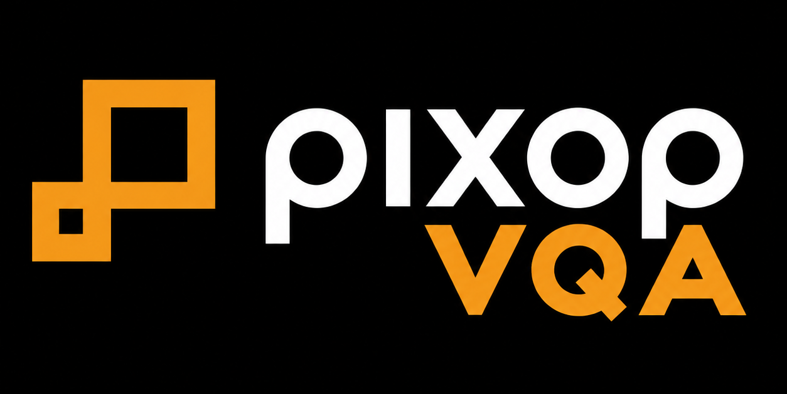

<p align="center">
  
</p>

# PixVQA — A Unified Video Quality Assessment Tool by Pixop

[](https://github.com/pixop/pixvqa/actions/workflows/qa.yml) [](https://ffmpeg.org/) [](https://github.com/Netflix/vmaf) [](LICENSE)

PixVQA compares a reference sequence with a distorted sequence and prints text scores for the selected metrics. The default lists each frame and then a summary. Native metrics have no JSON mode. It reads raw planar YUV and, when built with FFmpeg, compressed video. Decoding uses the codec FFmpeg reports.

## Features

PixVQA supports PSNR, XPSNR, SSIM, MS-SSIM, VMAF, PU21-PSNR/SSIM/MS-SSIM, ColorVideoVDP, and CompressedVQA-HDR NR, with optional temporal Quality Consistency Score (QCS). It accepts raw YUV and, with an FFmpeg-enabled build, compressed video. CPU implementations are available for every native metric; optional CUDA acceleration is available for selected metrics and NVDEC decoding of supported HEVC/AV1 streams.

ColorVideoVDP is an optional Python/PyTorch backend, not a built-in native metric, and it is not installed with PixVQA. It outputs JOD scores: higher is better, and identical content scores 10. Compressed inputs such as MP4 are supported for SDR and HDR. Raw input is limited-range BT.2020/PQ YUV420p10le.

```bash
./bin/pixvqa --metrics cvvdp \
  -r reference.mp4 \
  -t distorted.mp4 \
  --cvvdp-interpretation pq \
  --cvvdp-display standard_hdr_pq
```

Installation, configuration, and detailed usage are in [ColorVideoVDP](docs/COLORVIDEOVDP.md).

CompressedVQA-HDR NR is also an optional Python/PyTorch backend.
It needs only a distorted compressed video and external upstream/model assets;
it preserves the published OpenCV decoding, sampling, preprocessing, and
calibration. It does not support raw YUV or `--frames`. Its QCS covers about
one sampled frame per second.

```bash
./bin/pixvqa --metrics cvqa-hdr-nr \
  -t distorted.mp4 \
  --cvqahdr-python /home/me/pixvqa-learned-env/bin/python \
  --cvqahdr-repo /home/me/src/CompressedVQA-HDR \
  --cvqahdr-checkpoint /home/me/models/NR_HDR_VQA.pth \
  --cvqahdr-profile /home/me/models/NR_HDR_VQA.npy
```

See [CompressedVQA-HDR NR](docs/COMPRESSEDVQA_HDR.md) for input constraints and
machine-readable output.

Both learned metrics run in one pinned Python environment
([learned-metric environment](docs/LEARNED_ENVIRONMENT.md)). A local
`config/learned_metrics.local.toml` stores the interpreter, model paths, and
`PATH` additions, so the commands above need no `--cvvdp-python` or `--cvqahdr-*`
options. Command-line options still override it. See
[learned-metric config](docs/LEARNED_METRICS_CONFIG.md).

`--device cpu|gpu|auto` (alias of `--metric-device`) applies to the learned
metrics as well. `gpu` requires CUDA and never falls back to the CPU. `auto`
uses CUDA when PyTorch sees a device. CPU and CUDA scores agree to about 1e-6;
see [learned metrics on CPU and CUDA](docs/LEARNED_DEVICES.md).

With `--qcs`, both learned metrics default to the QCS interval **[0, 10]**.
The interval is used only for QCS and never clamps the reported JOD or NR
score. CVVDP QCS integrates a per-frame JOD-equivalent sequence taken from the
official full-video pass; it is an extension of the video-level model (see
[QCS](docs/QCS.md#learned-metrics)).

`--metrics sdr`, `--metrics pq`, and `--metrics hlg` each select that
transfer's metric set and its colorimetry and display. Comma-separated metric
names still select only the metrics you name
([metric groups](docs/CLI_USAGE.md#metric-groups)).

One HDR10 command runs every supported metric. `--preset hdr` selects them,
sets PQ, BT.2020 primaries, the `bt2020nc` matrix, and limited range, the bundled
HDR VMAF model, and CVVDP's `pq` / `standard_hdr_pq` display. Each metric is
printed on its own, then one summary lists every score. The build needs FFmpeg
and libvmaf (`make swdec` or `make full` with libvmaf). `--frames` is rejected
because NR reads the whole clip. See the
[HDR master command](docs/CLI_USAGE.md#hdr-master-command).

Native metrics, `cvvdp`, and `cvqa-hdr-nr` can be combined in one
`--metrics` list. PixVQA validates every selected metric and preflights each
Python backend before running anything. It then runs native metrics, CVVDP, and
NR in that order and prints one summary. `-t` is always required. `-r` is
required when any full-reference metric is selected. When `cvqa-hdr-nr` is the
only metric, `-r` is ignored. See
[mixed native and learned metrics](docs/CLI_USAGE.md#mixed-native-and-learned-metrics).

See [supported metrics, SDR/HDR recommendations, pixel formats, and CPU/GPU capabilities](docs/METRICS_AND_FORMATS.md).

## Quick Start

Supported platform: Linux x86-64 (including Ubuntu 22.04/24.04 and WSL2). Native Windows builds have not been validated.

```bash
git clone https://github.com/pixop/pixvqa.git
cd pixvqa
bash install_pixvqa.sh
./bin/pixvqa --version
python3 scripts/run_qa.py --profile smoke
```

The guided installer sets up dependencies and lets you select CPU-only, FFmpeg software decoding, or optional CUDA/NVDEC support. CUDA/NVDEC requires a compatible NVIDIA driver and CUDA toolkit 12.8 installed.

To compare the bundled HEVC samples (requires software decoding or the full build):

```bash
./bin/pixvqa --metrics psnr,ssim,msssim \
  -r samples/ref_hevc.mp4 \
  -t samples/dist_hevc.mp4
```

CPU-only builds use raw YUV inputs. For dependency locations, `make cpu`, `make swdec`, `make full`, installation prefixes, and troubleshooting, read the [installation and build guide](docs/GETTING_STARTED.md).

## Documentation

**Getting started:** [Installation & builds](docs/GETTING_STARTED.md) · [Manual installation](docs/INSTALL.md) · [Make build guide](docs/BUILD_MAKE.md) · [Installation validation](docs/INSTALL_VALIDATION.md)

**Using PixVQA:** [CLI examples & options](docs/CLI_USAGE.md) · [Supported metrics & formats](docs/METRICS_AND_FORMATS.md) · [ColorVideoVDP](docs/COLORVIDEOVDP.md) · [CompressedVQA-HDR NR](docs/COMPRESSEDVQA_HDR.md)

**Technical guides:** [PU21 / HDR](docs/PU21.md) · [QCS](docs/QCS.md) · [Learned metrics on CPU/CUDA](docs/LEARNED_DEVICES.md) · [CI](docs/CI.md)

**Additional information:** [References](docs/REFERENCES.md) · [Licensing](docs/LICENSING.md)

## License

PixVQA is licensed under the [MIT License](LICENSE) (SPDX `MIT`). Copyright (c) 2026 Pixop ApS. [docs/LICENSING.md](docs/LICENSING.md) explains third-party and model licenses. Dependency notices are in [THIRD_PARTY_NOTICES.md](THIRD_PARTY_NOTICES.md).

The logo at `docs/brand/pixop-vqa-logo-crop.png` is included with the repository. The MIT license does not grant unrestricted trademark or logo use. See [docs/brand/README.md](docs/brand/README.md).
