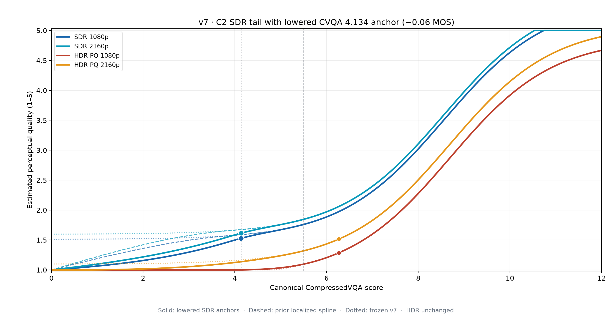

> **Historical v4 reference (superseded):** This page documents the earlier −0.060 MOS / SDR join 5.5 implementation. The same feature branch now uses **−0.080 MOS / join 5.65**, documented in [v5 selected local C² tail](CVQA_MOS_V7_LOCAL_TAIL_008.md). The figures and tables below are retained for historical comparison.

> **Historical record:** Superseded for runtime on 27 November 2026 by [canonical B08](CVQA_MOS_A2_TV123_INTEGRATION.md). Earlier commands, selectors and module paths below describe the archived implementation, not current PixVQA.

# PixVQA CVQA-to-MOS: local C² endpoint correction for frozen v7

**Research feature branch: feature/cvqa-mos-v7-local-tail-006**
**Date: 19 November 2026**
**Status: Feature-branch implementation only; not merged to main or production-certified.**

## Selected curves

The frozen v7 M1 sigmoid coefficients, original M7 SDR/PQ resolution corrections, source-normalization statistics and native-MOS offset are **unchanged**. A separate local spline replaces only the low-quality extrapolation:

- **SDR 1080p/2160p:** monotone three-segment C² cubic B-spline for CVQA below 5.5, with estimated MOS(0) = 1 and the two SDR anchors at CVQA 4.1344840888613135 lowered by exactly **0.060 MOS**. At 5.5 the spline matches original v7 value, first and second derivatives.
- **HDR PQ 1080p:** unchanged earlier localized C² two-segment quintic, keeping MOS 1 below approximately CVQA 3.604 before a smooth transition into v7.
- **HDR PQ 2160p:** unchanged earlier localized C² two-segment cubic lower tail.
- **All routes:** original frozen v7 returned without any modification for SDR scores at or above 5.5 and HDR PQ scores at or above 6.268450107554486.

The original v7 upper clip is retained, so the *entire* mapping must not be described as globally C². CVQA input score and out-of-support flags remain unchanged.

### Four-route curve comparison

[Low-score detail](figures/cvqa_mos_v7_local_c2_minus006_low_zoom.png)

Solid lines: selected v7 + local C² tail. Dashed SDR lines: previous −0.040 candidate. Dotted lines: frozen v7.

## Exact mathematical implementation

For transfer T and encoded height h, the original v7 baseline is

\[
M_{v7}(x,T,h)=\operatorname{clip}\left(1+4\sigma\left(a_T+b_T\frac{x-\mu_T}{s_T}\right)+d_{T,h},1,5\right).
\]

The selected endpoint adapter returns 1 for nonpositive scores; a local monotone spline below the transfer-specific join; and **exactly** the original v7 value at and above the join.

For SDR, normalized coordinate u=x/5.5, knots:

[0,0,0,0, 0.675,0.7517243797929661, 1,1,1,1]

| SDR resolution | Six C² B-spline control-point values |
|---|---|
| 1080p | 1, 1.071203626442647, 1.173213802685994, 1.6078430559583194, 1.6658847855895467, 1.7599549658046365 |
| 2160p | 1, 1.1125779034496566, 1.2586489707487993, 1.6932782240211297, 1.7513199536523565, 1.845390133867446 |

The two simple interior knots guarantee C² continuity; the nondecreasing controls guarantee monotonicity.

| SDR anchor at CVQA 4.134484 | Frozen v7 MOS | New MOS | Delta |
|---|---:|---:|---:|
| 1080p | 1.5886443028 | **1.5286443028** | −0.060 |
| 2160p | 1.6740794709 | **1.6140794709** | −0.060 |

For HDR PQ, the prior study's exact parameters are preserved: PQ1080 normalized knot 0.575 and right-hand quintic Bézier controls [0,0,0,0.015195872364660537,0.10925972083011509,0.286185374125175]; PQ2160 normalized knot 0.775 and truncated-cubic coefficients [4.497130586296919e-13,0.03565801406825231,0.424084613684314,4.858656163750658].

The pure-Python runtime implementation is [mos_low_tail.py](../../python/pixvqa_cvqahdr/mos_low_tail.py), with no NumPy or SciPy inference dependency.

## Accuracy comparison with original v7

**Native subjective MOS: unchanged for all tested clips** (all are above the relevant low-tail join).

| Dataset | Bias | MAE | RMSE | PLCC | SRCC |
|---|---:|---:|---:|---:|---:|
| SDR54 | +0.020909 | 0.278034 | 0.336012 | 0.894322 | 0.803710 |
| HDR35 | +0.441124 | 0.604153 | 0.806904 | 0.720042 | 0.723094 |
| VD6 | +0.056050 | 0.307850 | 0.395908 | 0.698888 | 0.771429 |

**Source-disjoint development converted-MOS targets:**

| Dataset | Model | Bias | MAE | RMSE | PLCC | SRCC |
|---|---|---:|---:|---:|---:|---:|
| SDR200 | Original v7 | +0.042608 | 0.688583 | 0.856790 | 0.708320 | 0.703672 |
| SDR200 | Local C² −0.060 | +0.042160 | 0.688140 | 0.856755 | 0.708330 | 0.703672 |
| HDR PQ192 | Both unchanged | +0.145259 | 0.487483 | 0.621260 | 0.762126 | 0.737846 |

Nine of 200 SDR development rows change. Their **retrospective postprocessed-OOF** metrics are not a new nested validation. Equal native ratings are a by-design preservation result, not evidence of improved subjective accuracy on the unsupported lower tail.

## Version and provenance

The historical policy ID **selected_s1_sdr_p1_hdr_c0** stays unchanged for protocol compatibility. Feature-branch calibration version:

**selected-s1-sdr200-pq192-v7-local-c2-20261119-v4**

Original v7 fitted coefficient JSON, fitted source SHA, selection locks and historical golden fixtures remain unchanged. Effective digest payloads now include **the actual low-tail coefficients and version**, and JSON calibration metadata exposes the new low-tail specification.

A new 48-point research oracle fixture independently checks the four routes, in addition to unchanged 68 selected v7 golden cases, 89 native AVT clips and six VD6 samples.

Regression tests:

    PYTHONPATH=python .venv/bin/python -B scripts/test_cvqahdr_mos_calibration.py
    PYTHONPATH=python .venv/bin/python -O -B scripts/test_cvqahdr_mos_calibration.py

Validation includes endpoint and anchor values, joined curvature/slope, monotonicity, bounds, exact v7 parity at and above joins, provenance and tamper detection, routing and upstream gating.

## Scientific and deployment limitations

This is a **geometry-constrained extrapolation** with no rated native MOS targets below the modified intervals. The preservation cutoffs were chosen retrospectively after inspecting dataset CVQA distributions. No independent subjective-accuracy improvement has been established; the original upper MOS clipping persists.

**No merge to main, no production release, and no alteration of the canonical CompressedVQA quality score.**

References: [Original frozen v7 calibration](CVQA_MOS_TRANSFER_SEPARATED_V7.md), [SDR −0.060 research study](https://github.com/pixop/perceptual-optimization/tree/feature/bilawa-cvqa-mos-20261114/calibration/production_readiness_20261113/CVQA_MOS_V7_SDR_ANCHOR_REFINEMENT_20261119), and [HDR local C² study](https://github.com/pixop/perceptual-optimization/tree/feature/bilawa-cvqa-mos-20261114/calibration/production_readiness_20261113/CVQA_MOS_V7_LOCAL_SPLINE_C2_20261119).
