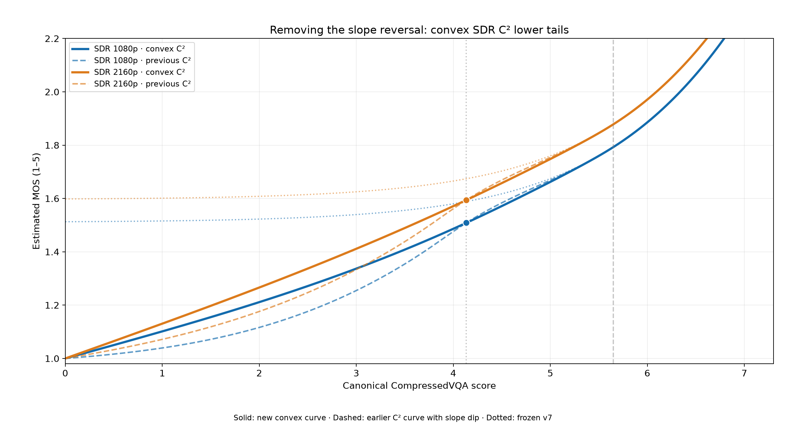

# PixVQA v7 — convex C² SDR lower-tail calibration

**Research feature branch:** feature/cvqa-mos-v7-local-tail-006
**Model version:** selected-s1-sdr200-pq192-v7-convex-c2-20261119-v6
**Status:** Implemented on feature branch only. Not merged to main or subjectively certified.

## Why the previous curve needed correction

The prior −0.080 MOS (join CVQA 5.65) SDR curves were C² continuous but not convex. Their first derivatives fell between CVQA 3.8 and 5.0, producing the visible shoulder. In the new version, both SDR curves are explicitly constrained to **nonnegative second derivative** throughout the low-score interval. Therefore their slope cannot decrease as CVQA increases.

The original fitted v7 M1 sigmoid, M7 corrections, SDR native offset, colorimetry routing, upstream profile checks and source hashes are frozen.

[First-derivative comparison: old reversal and new nondecreasing slope](figures/cvqa_mos_v7_convex_c2_slope.png)

Solid: new convex model. Dashed: previous C² model. Dotted: original frozen v7.

## Mathematical specification

The new SDR calibration is a degree-3 B-spline of the normalized coordinate u=x/5.65, with **10 control points per resolution** and the following 14 knots:

    [0,0,0,0, 0.19,0.4308835476868419,0.6717670953736838,
     0.7317670953736838,0.8524719024555261,0.9463534190747368,
     1,1,1,1]

Use the spline only for nonnegative CVQA below 5.65, return exactly MOS=1 at CVQA 0, and return the unchanged original v7 function at and above CVQA 5.65.

The fitted control-point vectors are embedded in [mos_low_tail.py](../../python/pixvqa_cvqahdr/mos_low_tail.py) and retained at full precision in the [research models file](https://github.com/pixop/perceptual-optimization/blob/feature/bilawa-cvqa-mos-20261114/calibration/production_readiness_20261113/CVQA_MOS_V7_SDR_CONVEX_TAIL_20261119/models_convex.json). The selected model minimizes bending plus a small jerk penalty subject to exact endpoint value, first derivative, second derivative, and **nonnegative curvature at every knot**. Because the cubic spline curvature is continuous and piecewise linear, those constraints guarantee convexity throughout the low tail.

**The two CVQA 4.134484 anchor values remain exactly where requested:**

| SDR route | Frozen v7 MOS | New convex MOS | Difference |
|---|---:|---:|---:|
| SDR1080 | 1.5886443028 | **1.5086443028** | −0.080 |
| SDR2160 | 1.6740794709 | **1.5940794709** | −0.080 |

Both curves are C² continuous at every interior knot and when rejoining original v7 at CVQA 5.65, matching its value, slope and curvature.

### Direct derivative comparison

| CVQA | Prior SDR1080 slope | Convex SDR1080 slope | Convex SDR2160 slope |
|---:|---:|---:|---:|
| 0 | 0.0284 | **0.0998** | **0.1295** |
| 3.8 | 0.2514 | **0.1577** | **0.1649** |
| 4.134484 | 0.2323 | **0.1674** | **0.1710** |
| 4.5 | 0.1832 | **0.1766** | **0.1770** |
| 5.0 | 0.1666 | **0.1859** | **0.1848** |
| 5.65 | 0.2319 | **0.2319** | **0.2319** |

Minimum low-tail curvature is approximately **+0.001279** in SDR1080 and **+0.000782** in SDR2160. The slope no longer reverses.

## HDR PQ remains unchanged

The HDR PQ 1080p localized C² quintic and PQ2160 localized C² cubic are retained exactly. Both return to frozen v7 at CVQA **6.268450107554486**. The original upper v7 clipping remains; the entire composite mapping is not globally C².

## Accuracy comparison

| Dataset | Model | Bias | MAE ↓ | RMSE ↓ | PLCC ↑ | SRCC ↑ |
|---|---|---:|---:|---:|---:|---:|
| SDR200 | Frozen v7 | +0.042608 | 0.688583 | 0.856790 | 0.708320 | 0.703672 |
| SDR200 | Prior C² −0.080 | +0.041951 | 0.688014 | 0.856742 | 0.708332 | 0.703672 |
| SDR200 | **Convex C² −0.080** | **+0.041772** | **0.687860** | **0.856724** | **0.708340** | **0.703672** |
| HDR PQ192 | All unchanged | +0.145259 | 0.487483 | 0.621260 | 0.762126 | 0.737846 |
| SDR54 | All unchanged | +0.020909 | 0.278034 | 0.336012 | 0.894322 | 0.803710 |
| HDR35 | All unchanged | +0.441124 | 0.604153 | 0.806904 | 0.720042 | 0.723094 |
| VD6 | All unchanged | +0.056050 | 0.307850 | 0.395908 | 0.698888 | 0.771429 |

Only **10/200** SDR development observations are affected. The differences are retrospective postprocessing of historical source-disjoint predictions, not a fresh nested validation. Identical native-rated performance is partly by design: no native subjective MOS observations fall below the selected cutoffs.

## Implementation and validation

The production-facing feature-branch low-tail evaluator remains pure Python with no SciPy dependency. Its updated 10-control-point SDR spline is versioned in the **effective calibration digest**; the underlying fitted v7 source SHA and original historical fixtures are unchanged.

Regression tests check all four routes, exact SDR anchor shifts, MOS(0)=1, SDR nondecreasing slopes, overall monotonicity, C² joins, unchanged high-score v7 values, source integrity, and tamper detection. A separate 48-point numerical fixture was generated from the independent research coefficients.

**Scientific caveat:** The stronger convexity constraint removes a mathematical slope artifact, but the low-score tail is still an engineering extrapolation with no native subjective MOS 1–5 support. It increases some predictions at CVQA 1–3 relative to the prior model; do not claim improved subjective accuracy there.

## Research and history

- [Convex C² research report, evidence and independent audit](https://github.com/pixop/perceptual-optimization/tree/feature/bilawa-cvqa-mos-20261114/calibration/production_readiness_20261113/CVQA_MOS_V7_SDR_CONVEX_TAIL_20261119).
- [Previous nonconvex −0.080 C² calibration](CVQA_MOS_V7_LOCAL_TAIL_008.md).
- [Original frozen v7 specification](CVQA_MOS_TRANSFER_SEPARATED_V7.md).

**Branch-only update; no merge to main.**
